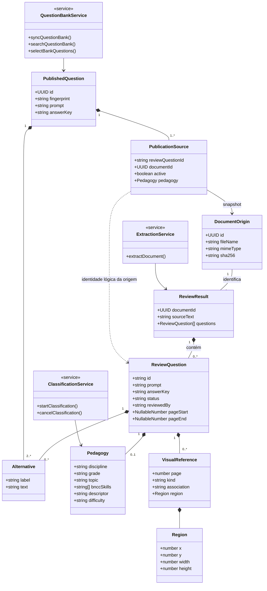
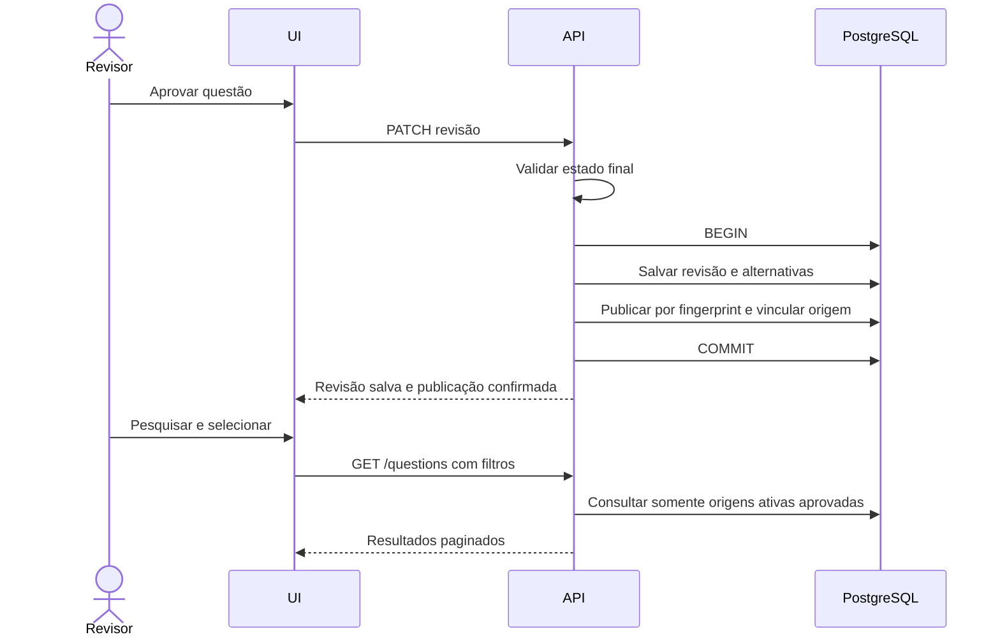

# Modelo de domínio e diagrama de classes

O diagrama representa entidades e serviços lógicos. Os serviços são implementados como funções TypeScript, não como classes instanciadas.

A relação entre PublicationSource e a revisão é lógica: o conteúdo publicado não é apagado em cascata por remoção administrativa da revisão. A limpeza automática protege origens com publicações ativas. Alternativas publicadas e snapshots são valores JSONB; as alternativas da revisão possuem tabela relacional própria.

