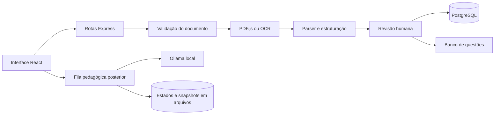
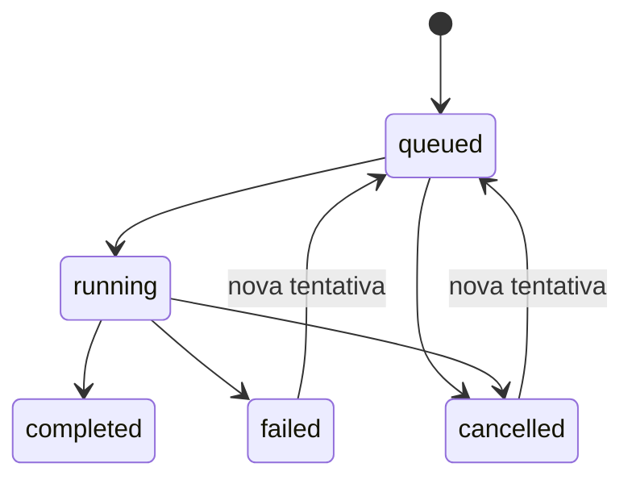

# Guia do código do Mentary

Referência técnica da implementação, revisada em 12/11/2026. Para instalar e executar, consulte o [README](../README.md); para requisitos e entregas, consulte a [auditoria das issues](AUDITORIA-ISSUES.md). A primeira entrega de avaliações, rascunhos duráveis e coordenação PostgreSQL está detalhada em [Avaliações e integração](AVALIACOES-E-INTEGRACAO.md). Login e autorização pertencem ao sistema principal, conforme decisão do responsável.

## 1. Arquitetura e pontos de entrada

O frontend React/TypeScript usa Vite. A API Express/TypeScript coordena PDF.js, Tesseract.js, PostgreSQL e Ollama. O mesmo backend serve o frontend compilado em produção.



| Arquivo | Responsabilidade |
| --- | --- |
| `src/backend/src/server.ts` | Inicializar banco/migrações, importar legado, publicar aprovações antigas válidas, executar retenção e iniciar HTTP. |
| `src/backend/src/app.ts` | Montar JSON, rotas, frontend estático e tratamento central de erros. Não inicia servidor, permitindo testes com Supertest. |
| `src/frontend/src/main.tsx` | Montar React em StrictMode e importar estilos. |
| `src/frontend/src/components/Workspace.tsx` | Navegação interna entre envio/revisão e banco, mantendo a revisão montada. |
| `src/frontend/vite.config.ts` | Desenvolvimento e proxy das chamadas da API; build em `src/backend/public`. |

`GET /health` verifica que o processo HTTP responde. Não comprova disponibilidade do banco, OCR ou Ollama.

## 2. Fluxo de envio e extração

1. `documents.routes.ts` aplica o limite de uploads e o Multer em memória.
2. `documents.controller.ts` verifica presença do arquivo e cria um AbortController ligado ao fechamento da resposta.
3. `document-validation.service.ts` confere extensão, MIME, assinatura, abertura, páginas e dimensões de imagens.
4. `document-extraction.service.ts` avalia cada página: texto digital suficiente e legível usa PDF.js; página escaneada ou com camada quebrada usa renderização e OCR em português. PDFs mistos combinam métodos.
5. `question-identification.service.ts` executa parser, estruturação, filtro de candidatos objetivos e associação do gabarito impresso. Não chama Ollama.
6. `document-origin.service.ts` registra original, hash e manifesto. `review-results.service.ts` cria questões pendentes e referências visuais.
7. A resposta libera a revisão; o navegador solicita a classificação pedagógica separadamente. Falha da IA não desfaz a extração.

Cancelamento é cooperativo: há verificações entre etapas e páginas, interrupção da espera, cancelamento de renderização e encerramento do worker OCR ativo. Operações nativas já iniciadas podem precisar terminar. Origens criadas antes de detectar o cancelamento são desfeitas pelo controller quando aplicável.

Em desenvolvimento, `vite.config.ts` propaga o fechamento da resposta do navegador à requisição encaminhada para `/documents`. Abortar apenas o fetch do navegador, sem fechar a conexão upstream do proxy, podia deixar a API processando. `proxy-cancellation.test.ts` verifica esse elo usando Vite real e uma API fictícia; instale as dependências do frontend também para executá-lo.

### Limites implementados

| Recurso | Limite |
| --- | --- |
| Upload | PDF, PNG, JPG/JPEG; 20 MB; um upload ativo por instância |
| PDF | De 1 a 50 páginas |
| Imagem de entrada | Até 10.000 px por lado e 40 milhões de pixels |
| Canvas PDF para OCR/prévia | Até 10.000 px por lado e 40 milhões de pixels, validados antes da alocação |
| JSON de entrada | 100 KB |
| Seleção do banco | De 1 a 100 UUIDs |
| Paginação do banco | Padrão 20, máximo 100 por página; tela solicita 10 |

`canvas-limits.service.ts` limita a imagem renderizada, não o tamanho do PDF em bytes. Uma prévia de recorte pequeno ainda renderiza a página inteira antes de recortar; por isso a validação ocorre sobre o canvas completo.

## 3. Parser e estruturação

| Serviço | Função principal |
| --- | --- |
| `question-parser.service.ts` | Preparar linhas por página, reparar rótulos OCR contextualmente e alimentar a sessão. |
| `question-line-classifier.service.ts` | Distinguir marcadores explícitos, numeração, perguntas e continuação. |
| `question-parser-session.service.ts` | Manter a questão aberta entre linhas/páginas e ignorar instruções administrativas. |
| `question-assembly.service.ts` | Montar rascunhos, páginas e fragmentos repetidos. |
| `question-alternatives.service.ts` | Separar alternativas do enunciado, preservando rótulos. |
| `question-structure.service.ts` | Definir múltipla escolha, componentes faltantes e candidatos que exigem revisão. |
| `answer-key.service.ts` | Associar gabarito impresso à questão, sem inventar respostas ausentes. |

Um candidato numerado com alternativas danificadas pode continuar pendente. Isso evita descarte silencioso, mas não prova que todo candidato é uma questão válida. `confidence` é uma classificação interna do parser, não uma estimativa pedagógica de acerto da IA.

Lacunas em sequências convencionais como A/C ou 1/3 geram aviso de alternativas a conferir, sem inventar o item ausente. A ordem C/A/B não é uma lacuna. Rótulos deliberados continuam sujeitos à confirmação humana, sem impor numeração sequencial como regra de aprovação.

## 4. Elementos visuais

`visual-detection.service.ts` inspeciona operadores de imagem/desenho por página. Se essa inspeção falhar, retorna uma referência não confirmada e `extractionWarning`; texto legível continua disponível. O tipo `graphic` nesse fallback é um marcador de revisão da página, não comprovação de um gráfico reconhecido.

`question-regions.service.ts` estima limites por posição do texto e sequência de questões/colunas. `review-results.service.ts` associa regiões quando a correspondência é suficientemente determinada; o restante exige confirmação humana.

`source-preview.service.ts` valida página e recorte, renderiza PNG e limita dimensões. Coordenadas `x`, `y`, `width` e `height` variam de 0 a 1, com origem no canto superior esquerdo.

No frontend, `VisualSourceEditor.tsx` e `source-editing.ts` editam a referência principal. Alterar o recorte substitui a referência anterior e preserva secundárias. Salvar outros campos mantém associação automática/incerta e avisos existentes; confirmar um recorte válido registra associação manual.

## 5. Revisão, persistência e concorrência

`review-results.service.ts` concentra normalização e validação. A questão aprovada deve ter enunciado, duas alternativas preenchidas e de rótulos únicos, gabarito correspondente e responsável. A regra vale também para edição de uma questão que já está aprovada. Uma alteração inválida não substitui o registro salvo.

Campos pedagógicos: área, tipo, disciplina, série, tema, BNCC, descritor e dificuldade. BNCC manual aceita uma lista de textos; não há consulta a catálogo oficial. UUIDs externos opcionais são validados em formato, não contra um provedor externo.

### Armazenamentos

| Local | Conteúdo |
| --- | --- |
| PostgreSQL `extrator.*` | Revisões, texto extraído, questões e alternativas. |
| PostgreSQL `banco.*` | Conteúdo publicado e snapshots das origens aprovadas. |
| `uploads/documents` | Arquivos originais. |
| `uploads/manifest.json` | Identidade, MIME, tamanho, hash e data dos documentos. |
| `uploads/classifications` | Estados, sugestões e snapshots de entrada da classificação. |
| `uploads/reviews` | Persistência de revisão sem PostgreSQL e importação do legado. |

Sem `DATABASE_URL`, a revisão pode usar arquivos; o banco de questões exige PostgreSQL. Ter um arquivo original no disco não garante que sua revisão esteja no banco, nem o inverso. Backup precisa preservar banco e uploads conjuntamente.

### Garantias e limites

- `document-lock.service.ts` serializa alterações de uma revisão, início/consulta de classificação e retenção do mesmo documento na instância atual. Documentos diferentes continuam independentes; uma operação rejeitada não bloqueia a próxima.
- Funções públicas que adquirem o bloqueio chamam variantes internas `...Unlocked` quando necessário. Não readquirir o mesmo bloqueio de dentro dele: não é um mutex reentrante.
- `postgres-review.service.ts` lê documento, questões e alternativas em transação `REPEATABLE READ READ ONLY`, evitando misturar versões de commits diferentes.
- Gravação da revisão e sincronização do banco ocorrem na mesma transação PostgreSQL.
- Com PostgreSQL, `document-lock.service.ts` usa trava transacional entre processos e `document-transaction.ts` compartilha o cliente na leitura/alteração/publicação. O hash `revision` e o PATCH com `expectedRevision` detectam edição de versão antiga (409). Clientes antigos sem o campo precisam ser atualizados. O modo por arquivos continua limitado a uma instância.
- A gravação atual substitui o conjunto de questões da revisão; otimizações futuras precisam manter atomicidade e publicação. Não chamar diretamente o gravador de baixo nível para editar uma revisão já existente sem a coordenação necessária.

## 6. Publicação e consulta

`question-bank.service.ts` reúne elegibilidade, fingerprint, publicação, filtros e seleção. Somente origens aprovadas ativas aparecem no banco. Reabrir ou rejeitar desativa aquela origem; outra origem aprovada pode manter a publicação disponível.

O fingerprint normaliza Unicode/espaçamento e rótulos, mantendo ordem de alternativas, gabarito e diferenças relevantes do conteúdo. A restrição UNIQUE impede duplicatas dessa representação. Não identifica paráfrases ou equivalência matemática geral.

A busca combina filtros por AND e procura uma origem ativa que satisfaça todos. A seleção é revalidada antes de retornar; itens retirados não são exportados silenciosamente. Exportação JSON não é montagem de uma prova diagramada.

## 7. Classificação pedagógica

`pedagogical-classification.service.ts` controla fila serial de até 20 documentos ativos, cache versionado por conteúdo/modelo, gravações serializadas, cancelamento e retentativa. `ollama.service.ts` monta o contrato de saída, limita trechos de entrada e valida a resposta. Texto original permanece preservado na revisão.



Uma questão é enviada por chamada. Timeout recebe uma nova tentativa; resultados anteriores são persistidos. Série só é aceita quando confirmada no conteúdo ou já informada pelo revisor. Área é mapeada a partir de disciplinas conhecidas; BNCC não é gerada.

O frontend preenche campos vazios e exige salvar. Mudanças relevantes sinalizam resultado desatualizado. Falha/cancelamento com sugestões mostra resultados parciais explicitamente.

Com PostgreSQL, `durable-classification.service.ts` persiste tarefas e cursor, usa posse/lease e limita chamadas ao modelo entre servidores. O worker do `server.ts` retoma tarefas após expiração do lease e percebe cancelamentos persistidos. Sem PostgreSQL permanece a retentativa manual após reinício. Cancelar o fetch não garante descarregar imediatamente o modelo da GPU. Veja os detalhes e limites no guia de integração.

## 8. Retenção

`document-retention.service.ts` usa data do upload, prazo padrão de 30 dias e execução na inicialização/diariamente. `0` desativa a limpeza.

Para cada candidato, dentro do bloqueio do documento, a limpeza verifica se há classificação ativa e publicação ativa. Tarefas ativas são adiadas; origens publicadas são preservadas. A exclusão remove revisão, snapshot de classificação e original/manifesto. Se uma etapa falhar, a exceção é registrada e o manifesto restante permite nova tentativa; não existe transação única entre disco e banco.

## 9. API e erros

| Método e rota | Entrada e resultado |
| --- | --- |
| `GET /health` | `{"status":"ok"}`; apenas disponibilidade HTTP. |
| `POST /documents` | Multipart no campo `document`; retorna origem, páginas, método, texto, questões e URL de revisão. |
| `GET /documents/:id/review` | Revisão persistida, questões e IDs publicados quando houver banco. |
| `PATCH /documents/:id/review/questions/:questionId` | Campos editáveis da questão; retorna revisão atualizada. |
| `GET /documents/:id/source` | Original com MIME e disposição inline. |
| `GET /documents/:id/preview` | `page`, `x`, `y`, `width`, `height`; retorna PNG. |
| `POST /documents/:id/classification` | Inicia/reutiliza análise; HTTP 202 com estado. |
| `GET /documents/:id/classification` | Estado, sugestões e indicação `stale`. |
| `POST /documents/:id/classification/cancel` | Cancelamento idempotente de tarefa ativa. |
| `GET /questions` | `q`, `discipline`, `grade`, `topic`, `bncc`, `descriptor`, `difficulty`, `page`, `pageSize`. |
| `GET /questions/:id` | Publicação disponível e origens. |
| `POST /questions/selection` | `{"ids":["uuid"]}`; questões na ordem selecionada. |

Exemplo de atualização, sem aprovação automática:

```json
{
  "prompt": "Quanto é 2 + 2?",
  "alternatives": [{"label":"A","text":"3"},{"label":"B","text":"4"}],
  "answerKey": "B",
  "status": "pending_review",
  "reviewedBy": "Revisor",
  "pedagogy": {"discipline":"Matemática","difficulty":"easy"}
}
```

| HTTP | Situação implementada |
| --- | --- |
| 400 | JSON inválido, validação de documento/campos/filtros, seleção inválida ou indisponível. |
| 404 | Documento/revisão/análise não encontrados nas rotas que fazem essa distinção. |
| 413 | Upload acima de 20 MB ou JSON acima de 100 KB. |
| 422 | Documento sem texto legível ou limite de renderização excedido. |
| 429 | Outro upload ocupa o limite da instância. |
| 500 | Falha inesperada de processamento/armazenamento, com mensagem genérica. |

Os erros tratados usam `{"error":"mensagem"}`. Ainda não há taxonomia de códigos de erro, OpenAPI gerado ou autenticação. Em particular, `GET /questions/:id` reutiliza a seleção: item ausente retorna erro de validação 400, não 404. Não presumir autorização a partir de um UUID conhecido; isolamento institucional está em #40.

## 10. Frontend

| Arquivo | Papel |
| --- | --- |
| `pages/App.tsx` | Orquestrar arquivo, revisão, rascunhos, salvamento e acompanhamento da classificação. |
| `pages/QuestionBank.tsx` | Filtros, paginação, seleção revalidada e download JSON. Cancela seleção pendente ao desmontar. |
| `components/QuestionContentEditor.tsx` | Editar enunciado e alternativas. |
| `components/PedagogyFields.tsx` | Campos pedagógicos, BNCC manual e dificuldade. |
| `components/VisualSourceEditor.tsx` | Consultar original e ajustar página/recorte. |
| `types/review.ts` | Tipos consumidos pela interface. Não substituem validação em tempo de execução. |
| `utils/review-draft.ts` | Criar defaults e limpar somente a versão de rascunho efetivamente salva. |
| `utils/alternative-editing.ts` | Relabeling, remoção e geração do próximo rótulo. |
| `utils/pedagogy-filling.ts` | Preencher somente campos vazios, preservando dados humanos. |
| `utils/classification-progress.ts` | Traduzir estados e indicar parciais. |
| `utils/source-editing.ts` | Validar coordenadas e substituir a referência visual principal. |
| `utils/api-response.ts` | Ler o corpo uma vez, tratar HTTP/JSON inválido e preservar erros da API. |
| `utils/question-presentation.ts` | Textos de apresentação da questão objetiva. |

Rascunhos sobrevivem à navegação interna na mesma aba. O usuário pode habilitar armazenamento local por sete dias e recuperar versões compatíveis após recarga/fechamento, baixar o conteúdo para conciliação ou descartá-lo. `App.tsx` ainda concentra estados e efeitos: futuras extrações devem preservar cancelamento e a regra de não apagar edições feitas durante um salvamento. Limpeza ao trocar de usuário depende da integração com o sistema principal.

O Workspace mantém o endereço da revisão ativa, permitindo reabrir a versão salva após recarga. O campo BNCC mantém separadores durante a digitação e transforma o texto em lista; não eliminar a vírgula ao normalizar um campo controlado a cada tecla.

## 11. Configuração

Use `.env.example` como base; não versionar `.env` nem credenciais reais.

| Variável | Uso/padrão |
| --- | --- |
| `PORT` | HTTP, padrão 3000. |
| `DATABASE_URL` | PostgreSQL; ausente habilita revisão por arquivos, mas não o banco de questões. |
| `DATABASE_POOL_MAX` | Máximo de conexões, padrão 10. |
| `DATABASE_CONNECTION_TIMEOUT_MS` | Espera de conexão, padrão 5000 ms. |
| `MENTARY_UPLOAD_REGISTRY` | Sobrescrever caminho do manifesto. |
| `MENTARY_DOCUMENT_DIRECTORY` | Diretório dos originais. |
| `MENTARY_REVIEW_DIRECTORY` | Diretório das revisões por arquivo/legado. |
| `MENTARY_CLASSIFICATION_DIRECTORY` | Diretório de classificações e snapshots. |
| `MENTARY_RETENTION_DAYS` | Prazo em dias: 30; zero desativa. |
| `OLLAMA_BASE_URL` | Padrão `http://127.0.0.1:11434`. |
| `OLLAMA_MODEL` | Necessário para classificar; não é necessário para extrair/revisar. |
| `OLLAMA_NUM_GPU` | Ajuste opcional de camadas na GPU; depende do hardware. |
| `OLLAMA_TIMEOUT_MS` | Padrão 300000 ms por chamada. |
| `OLLAMA_TARGET_MS` | Meta medida, padrão 15000 ms; não é timeout nem SLA. |
| `OLLAMA_KEEP_ALIVE` | Padrão `15m`. |

`QUESTION_IDENTIFIER` não controla mais a extração. Não criar ramificações novas baseadas nessa variável antiga.

## 12. Testes e manutenção

Execute nas pastas correspondentes:

```powershell
# src/backend
npm run lint
npm run build
npm test
npm run audit:source
npm run test:postgres
npm run test:ocr

# src/frontend
npm run lint
npm run build
```

PostgreSQL e OCR reais são integrações separadas. O teste PostgreSQL cria e remove apenas um banco temporário aleatório; exige permissão de criação. O teste OCR pode baixar dados públicos de português. A suíte geral não depende de Ollama real.

`audit:source` inventaria importações estáticas, arquivos sem caminho a partir das entradas, exportações sem referência em outros arquivos e classes CSS candidatas a remoção. É uma análise auxiliar: imports dinâmicos, contratos externos, tipos e classes construídas em execução exigem revisão manual. Ausência de candidatos não prova ausência de todo código morto.

Ao alterar o código:

1. Identifique a issue e o fluxo afetado, sem ampliar automaticamente o escopo para módulos futuros.
2. Acrescente regressão para o defeito observado; preserve texto original, vínculo de origem e revisão humana.
3. Migrações novas são adicionadas à lista em `database.service.ts`, sem editar o histórico já aplicado; atualize os testes que verificam versões e o contrato do banco.
4. Modificações em fingerprint/filtros exigem integração PostgreSQL. Parser/OCR exigem corpus correspondente. Fila exige testes de timeout, cancelamento e resultados tardios.
5. Evite usar `.then` em fila sem recuperar a rejeição anterior; uma falha não deve travar todas as próximas operações.
6. Não remova compatibilidades só porque o fluxo novo não as produz. Revisões e classificações antigas ainda podem precisar ser lidas.
7. Registre o resultado real das verificações e integre por Pull Request. Não confundir build local com CI aprovado ou pesquisa com professores.
